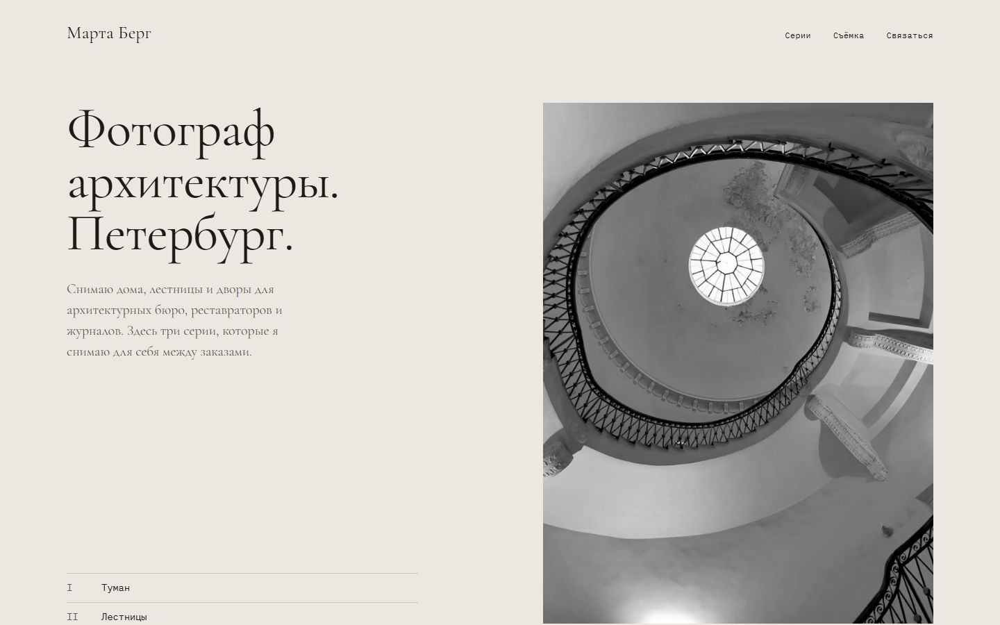
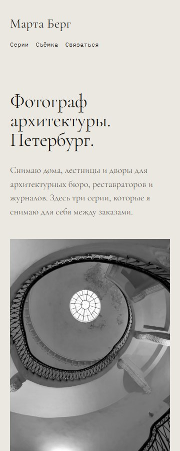

# Марта Берг

Portfolio site concept for a fictional architectural photographer in Saint Petersburg.

Концепт сайта для вымышленного фотографа архитектуры из Петербурга. Сайт сделан как зал выставки: три серии («Туман», «Лестницы», «Дворы»), крупные кадры и подписи как в каталоге, интерфейса почти не видно.

Демо: https://zaxdevv.github.io/marta-berg/





## Что на странице

- Три серии по пять кадров. Положение снимка зависит от композиции: на всю ширину, справа или в паре со смещением.
- У каждого кадра этикетка: номер, название, место, автор и лицензия со ссылкой на оригинал.
- Просмотр в полный размер через `<dialog>`: стрелки, Esc, фокус возвращается на кадр.
- Блок «Съёмка на заказ» с тремя видами работ и порядком съёмки, контакт по почте.
- Каталог всех кадров в конце страницы, он же список авторов.
- Страница 404 в той же стилистике.

## Как запустить

```sh
git clone https://github.com/zaxdevv/marta-berg
cd marta-berg
python -m http.server 8000
```

Откройте http://localhost:8000. Сборки нет, зависимостей нет.

## Как устроено

`index.html`, `css/style.css` и `js/viewer.js` (40 строк, только просмотрщик). Шрифты: Cormorant Garamond для текста и IBM Plex Mono для подписей, оба с кириллицей. Файлы woff2 лежат в `fonts/` (только латиница и кириллица), внешних запросов нет.

Фотографии лежат в `img/` в AVIF и WebP трёх ширин (720, 1280, 2000), браузер берёт нужную через `srcset`. Кадры переведены в ч/б с одинаковыми настройками контраста. EXIF удалён.

Lighthouse (мобильный профиль): производительность 96, доступность, лучшие практики и SEO: 100. axe и html-validate без ошибок.

## Ограничения

- Марты Берг не существует, почта `studio@example.com` ненастоящая, цены условные.
- Фотографии сделаны не ею: это снимки авторов Wikimedia Commons, список ниже.

## Фотографии

Все снимки взяты с Wikimedia Commons и переведены в ч/б. Изменённые версии распространяются на тех же условиях, что и оригиналы.

| № | Кадр | Автор | Лицензия |
|---|---|---|---|
| 01 | Фонарь, набережная | [Serge Novikoff](https://commons.wikimedia.org/wiki/File:Myst_(202916037).jpeg) | CC BY-SA 3.0 |
| 02 | Ветка, набережная | [Serge Novikoff](https://commons.wikimedia.org/wiki/File:Myst_(202916175).jpeg) | CC BY-SA 3.0 |
| 03 | Колокольня Никольского морского собора | [Sav-1667](https://commons.wikimedia.org/wiki/File:%D0%9A%D0%BE%D0%BB%D0%BE%D0%BA%D0%BE%D0%BB%D1%8C%D0%BD%D1%8F_%D0%9C%D0%BE%D1%80%D1%81%D0%BA%D0%BE%D0%B3%D0%BE_%D1%81%D0%BE%D0%B1%D0%BE%D1%80%D0%B0.jpg) | CC BY-SA 3.0 |
| 04 | Лёд, набережная | [Serge Novikoff](https://commons.wikimedia.org/wiki/File:Myst_(202916253).jpeg) | CC BY-SA 3.0 |
| 05 | Колоннада Казанского собора | [Александр Скибицкий](https://commons.wikimedia.org/wiki/File:%D0%9A%D0%BE%D0%BC%D0%B0%D0%BD%D0%B4%D0%BE%D1%80.jpg) | CC BY-SA 3.0 |
| 06 | Спираль, Садовая, 3 | [Alandislands](https://commons.wikimedia.org/wiki/File:Ordonnance_Haus_internal_staircase,_Sadovaya_3,_Saint_Petersburg_iii.jpg) | CC BY-SA 4.0 |
| 07 | Парадная, Гороховая, 64 | [Ninara](https://commons.wikimedia.org/wiki/File:Gorohovaya_Street_64_4A7A3585_Saint_Petersburg_(35769615751).jpg) | CC BY 2.0 |
| 08 | Пролёт, Чайковского, 42 | [Kaganer](https://commons.wikimedia.org/wiki/File:SPb_Tchaikovsky,_42_-_staircase_in_door_(2024-09-26).jpg) | CC BY-SA 4.0 |
| 09 | Световой фонарь, Садовая, 3 | [Alandislands](https://commons.wikimedia.org/wiki/File:Ordonnance_Haus_internal_staircase,_Sadovaya_3,_Saint_Petersburg_v.jpg) | CC BY-SA 4.0 |
| 10 | Окно на площадке, Гороховая, 64 | [Ninaras](https://commons.wikimedia.org/wiki/File:Gorokhovaya_street_64_in_Saint-Petersburg,_Russia.jpg) | CC BY 4.0 |
| 11 | Небо, Рубинштейна, 23 | [Kommunalka1912](https://commons.wikimedia.org/wiki/File:Rubinstein_Street_23_(Saint_Petersburg)_-_courtyard.jpg) | CC BY-SA 4.0 |
| 12 | Водосток | [Pavel Kirillov](https://commons.wikimedia.org/wiki/File:Courtyards_of_St.Petersburg_(25563816025).jpg) | CC BY-SA 2.0 |
| 13 | Провода, Рубинштейна, 27 | [Bestalex](https://commons.wikimedia.org/wiki/File:Saint_Petersburg._Rubinshteyn_Street,_27._Courtyard._-2024-01-28.jpg) | CC BY-SA 4.0 |
| 14 | Колодец, Гаванская, 32 | [Bestalex](https://commons.wikimedia.org/wiki/File:Saint_Petersburg._Gavanskaya_St.,_32_-_courtyard.jpg) | CC0 |
| 15 | Облако, 4-я линия В. О., 47 | [Florstein](https://commons.wikimedia.org/wiki/File:Courtyards_of_SPB_03.jpg) | CC BY-SA 4.0 |

## Лицензия

Код распространяется по MIT, см. [LICENSE](LICENSE). Фотографии опубликованы под лицензиями авторов из таблицы выше.
